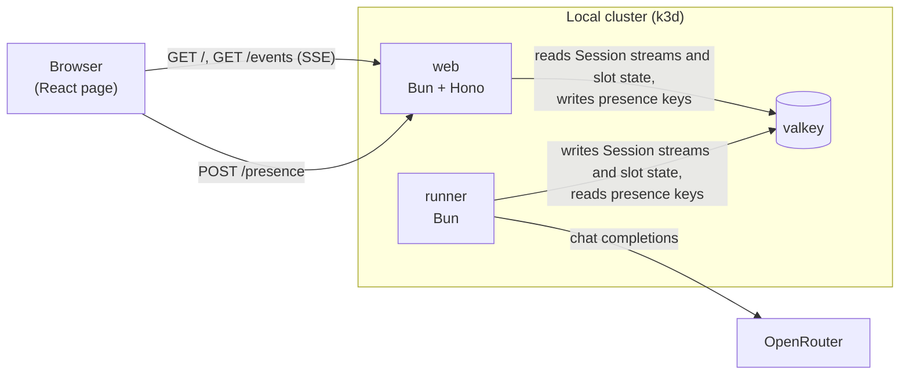
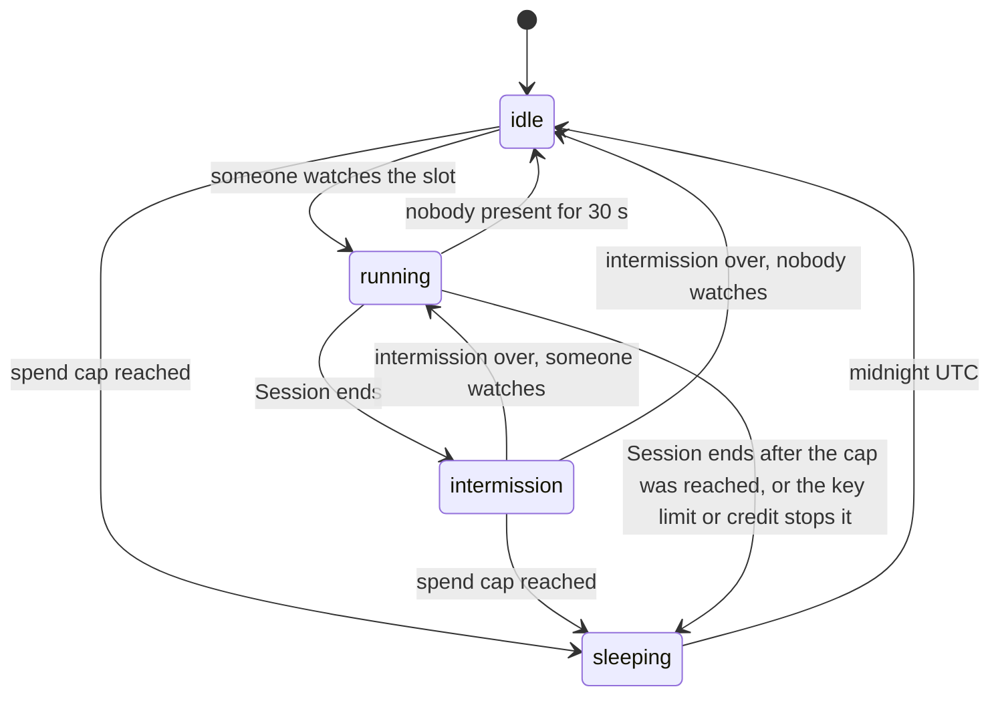
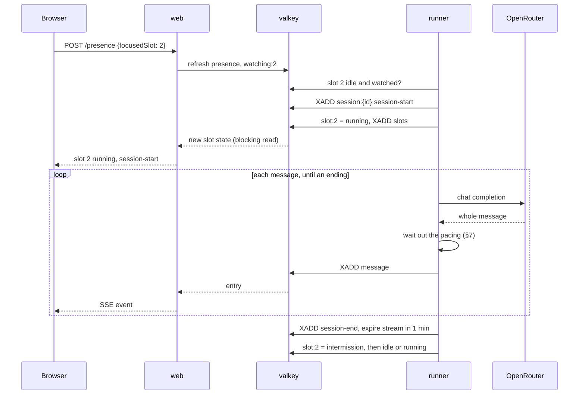

# Phase 1 — Architecture

How Phase 1 is built: the components, the contracts between them, the life of one Session and the layout of the Kubernetes manifests. What must be true is in the [spec](spec.md); terms are as the [glossary](../glossary.md) defines them; choices and their reasons are in the [decision log](../decisions.md). **Decision needed** marks a choice the author still has to make.

## 1. Overview

Three components run in the local cluster (D3):

- **runner** runs the Sessions: it calls the models, paces their output and writes each Session's events and each slot's state to Valkey.
- **web** serves the page, streams events and slot states to browsers over SSE, and records which viewers are present.
- **valkey** holds everything the other two share (D18).



**Principles**

- **Valkey holds the only copy of shared state.** The web pod keeps nothing that can't be rebuilt from Valkey. It can be replaced at any moment: browsers reconnect, and the new pod picks up where the old one stopped (D19).
- **The runner is the only writer of Sessions and slot state.** The web server only reads them; the only thing it writes is presence.
- **Viewing is read-only (S4.7).** Nothing from the browser reaches a Session. The only thing it sends is presence.

## 2. Repository layout

One repository with workspaces (D9), managed by `bun install` (D17):

```
apps/
  web/            Hono server (server/) and React front end (client/)
  runner/         Session loop, prompts, word lists
packages/
  shared/         event types, Valkey key names, settings, helpers
deploy/
  base/           Kustomize base: one folder per component
  overlays/local/ the local cluster
Tiltfile
cluster.yaml    the local cluster and its image registry (ctlptl)
```

The front end lives inside `apps/web`, because the web server serves it (D20) and Bun's dev server works by the server importing the page (D16). `packages/shared` holds whatever both sides of a contract must agree on, and the server, runner and front end all import it.

## 3. Valkey contract

| Key | Type | Written by | Read by | Content | Lifetime |
|---|---|---|---|---|---|
| `session:{id}` | Stream | runner | web | The Session's events (§4.1), in order | Expires 1 minute after the Session ends (D19). Limited to 10,000 entries as a safety net |
| `slots` | Stream | runner | web | Changes of slot state (§4.2) | Trimmed to the last 1,000 entries |
| `slot:{n}` | Hash | runner | web | The current state of slot *n*: `state` and `sessionId`. An empty `sessionId` means no Session | Permanent, overwritten. Removed when the slot count is lowered |
| `slot-count` | String (number) | runner | web | How many slots there are (D58) | Written at each runner start |
| `presence` | String | web | runner | Exists as long as any viewer is present | Expires 30 s after the last heartbeat (S2.7) |
| `watching:{n}` | String | web | runner | Exists as long as someone watches slot *n* | Expires 10 s after the last heartbeat |
| `spend:{date}` | String (number) | runner | runner | The day's spend in dollars (D11), with the date in UTC | Expires after 2 days |
| `sleeping:{date}` | String | runner | runner | Set when the provider refuses a call because the key's daily limit (S6.2) or the prepaid credit (D59) is spent | Expires after 2 days |

Key names, expiry times and limits are in `packages/shared`: constants, apart from `presence`'s lifetime, which is a shared setting.

**The slot count** is the runner's setting. The runner writes it to `slot-count` at start-up, and the web server reads it there and passes it to the page, so the two can't disagree (D58). The page ignores slots it doesn't know and shows missing ones as offline, which covers the moment while one side has restarted and the other hasn't.

**Slot numbers** start from 0, everywhere: in keys such as `slot:{n}`, in events and in the SSE cursor (§5.1). A slot's number is then also its position in a list of slots. Viewers never see the numbers (S4.3).

**Who may do what:** the runner and the web server each log in to Valkey as their own user, allowed only the keys and commands this table gives them (D46). The users are defined in the [Valkey component doc](components/valkey.md#6-users-and-permissions).

**Why expiring keys for presence:** a web pod that dies can't undo what it wrote. A counter of viewers would stay wrong forever, while a key it stops refreshing expires by itself (D21).

## 4. Events

All event types live in `packages/shared` as TypeScript types. They are *discriminated unions*: the `type` field says which event it is, and the compiler then knows which other fields come with it, so both sides must handle every kind.

### 4.1 Session events

The runner writes these to `session:{id}`, in this order:

```ts
type Role = "explorer" | "pretender";

type SessionEvent =
  | { type: "session-start"; sessionId: string; slot: number; kind: "terminal" }
  | { type: "message"; role: Role; text: string; codeword?: string }  // codeword: see §6.3
  | { type: "session-end"; ending: Ending };

type Ending = "found" | "ran-its-course" | "interrupted" | "sleeping";
```

Each `message` event holds one whole message (D31). The browser opens a message box for the role and types the text into it (§7).

`found`, `ran-its-course` and `interrupted` are the glossary's three endings. `sleeping` means the provider's key limit, or the prepaid credit running out (D59), stopped the Session partway through; the slot shows the sleeping notice below its last message (S6.2).

### 4.2 Slot state

The runner writes a `SlotStateEvent` to `slots` whenever a slot's state changes, and mirrors it in `slot:{n}`:

```ts
type SlotState = "idle" | "running" | "intermission" | "sleeping";

type SlotStateEvent = {
  type: "slot";
  slot: number;
  state: SlotState;
  sessionId?: string;  // set while running and during the intermission
};
```

- `idle`: the slot shows that it is waiting for someone to watch (S4.6).
- `running`: a Session is running.
- `intermission`: the 10 seconds between Sessions (S2.8). The fade to black (S4.17) is triggered by the Session's `session-end` event, not by this state; the state tells a viewer who arrives meanwhile that a Session has just ended and the slot isn't idle.
- `sleeping`: the slot shows "Machine is sleeping, come back tomorrow" (S6.2).

### 4.3 What the browser receives

The browser receives both kinds over one SSE connection, each tagged with its slot:

```ts
type SseEvent = { slot: number } & (SessionEvent | SlotStateEvent);  // D55
```

## 5. HTTP endpoints

The web component serves all of these (D14, D20).

| Endpoint | Purpose |
|---|---|
| `GET /` and static files | The page and its built assets |
| `GET /events` | One SSE connection per page, carrying all slots (D21) |
| `POST /presence` | Body `{ focusedSlot: number }`. Sent when focus or tab visibility changes, and every 5 s while the tab is active. Refreshes `presence` and `watching:{focusedSlot}` |

A hidden tab stops sending heartbeats but keeps `/events` open, so its Session keeps appearing at the normal pace (S4.9).

### 5.1 The SSE stream

Each SSE message carries one `SseEvent` as JSON in its `data:` field. Its `id:` field is the connection's **cursor**. For each slot, the cursor gives the Session the slot is showing and the last stream entry sent, for example `0:9f2c@1763045000000-0;1:a71b@1763045012345-3;2:-`. A slot with nothing running is `-`.

When the connection drops, the browser reconnects by itself and sends the last cursor back as `Last-Event-ID`. One connection carries three Session streams, so the cursor has to name a position in each.

On every connection, the web server first sends each slot's current state. Then, per slot:

- **The same Session is still running:** the entries after the cursor's position. This is the *catch-up read*.
- **The cursor's Session has ended but its stream hasn't expired:** the rest of that stream, so the viewer sees the ending. Then the slot's current Session, sent as for a new viewer.
- **No position in the slot's current Session:** a page opened while the Session is already running, or a reconnect whose cursor points to a Session that has since ended and expired. The web server sends the Session's `session-start` entry, then its latest `message` entry and anything after it. The latest message is the one browsers are revealing, so the viewer sees it from its start (S4.8); earlier messages aren't shown (spec §8: no recap for late joiners). A viewer who is already connected when a Session starts receives it from `session-start` onwards, live.

The web server's component doc describes how it merges the catch-up read with the live flow without gaps or repeats.

## 6. A Session's life

### 6.1 Slot states



When the spend cap is reached, running Sessions finish first (S6.2). Their slots then go straight to `sleeping` rather than to an intermission that would suggest another Session is coming.

### 6.2 One Session, step by step



**The runner** handles every slot in one process, with a loop per slot. Once a second, each loop checks its slot:

- **Idle:** start a Session if three things hold:
  - `watching:{n}` exists;
  - the day's spend in `spend:{date}` is below the cap;
  - `sleeping:{date}` doesn't exist.
- **Running:** if `presence` has expired, end the Session as interrupted and set the slot to `idle`. Nobody is there to see the ending.
- **Intermission:** when the 10 seconds are over, start the next Session if the slot is watched; otherwise set it to `idle`.

**Starting a Session:**

1. **A new Session ID**, random.
2. **A Codeword**, made of an adjective, a noun and a verb drawn at random from the word lists of the Pretender's kind, in `apps/runner/words/<kind>/` (S3.1, S3.2, D63).
3. **The prompts.** The prompts are files in `apps/runner/prompts/`, one for the Explorer and one per kind of Pretender. The runner reads them, and fills the Codeword into the Pretender's prompt only (S3.3). They are never sent to the browser (S3.4).
4. **An empty history.** The runner keeps the history itself, because a chat completion call is *stateless*: each call sends the whole conversation. Some providers offer conversations stored on their side, but those APIs differ between providers, which S5.2 rules out. The history is also small, and caching on the provider's side keeps resending it cheap.
5. **Announce it.** Write `session-start` to the new stream, then set `slot:{n}` to `running` and write the change to `slots`. The stream exists before anyone is told about it.

**The Explorer's first call.** The Explorer goes first (S2.2), so it has nothing to respond to yet, and some providers reject a call without a user message. So the Explorer's instructions are sent as its first *user* message rather than as a system prompt. The Pretender's instructions are its system prompt.

**Each turn:**

1. As soon as the previous message is written, the runner sends the next role's model its instructions and the full history (S5.4). Each model sees its own earlier messages as its own, and the other model's messages as coming from the other party. The call is an ordinary request, not streamed: the answer arrives whole (D31).
2. While the model generates, browsers are still revealing the previous message. When the answer arrives, the runner waits out the pacing (§7), then writes it as one `message` event.

**Endings:**

- **Found:** an Explorer message contains the Codeword exactly (S2.3).
- **Ran its course:** the 15th exchange ends without the Codeword having been found (S2.4).
- **Interrupted:** the call to the model provider for one message fails three times in a row, with a short wait between tries (S2.5).

### 6.3 The Codeword in the browser

The shimmer starts at the Codeword's first character (S4.15), so the browser must know the Codeword before it types it. The runner checks each whole Explorer message before writing it. When the message contains the Codeword, the `message` event carries it in its `codeword` field, and `session-end` with the ending `found` follows.

The browser therefore knows the Codeword before typing the first character of that message. As it types the Codeword, it lights up the same characters wherever the Codeword appeared earlier in the Pretender's output, in step.

## 7. Pacing

Text appears **character by character**, at a steady rate: 30 characters per second for the Explorer, 120 for the Pretender (S4.10), even though each message arrives whole.

**On the runner's side:**
- The runner writes a message only once 1.1 × (the previous message's characters ÷ its role's rate) has passed since it wrote the previous one.
- It generates the next message meanwhile, so generation is hidden whenever it takes less time than revealing the previous message. After a short message, such as a one-word command, it doesn't, and the wait shows as a pause before the next message. The multiplier, or a minimum pause, is to be tuned in trial runs so these waits feel even.

The runner is therefore about 10% slower than the display, and no backlog builds up in the browser.

**In the browser:**
- Each slot has a buffer of text that has arrived but isn't shown yet.
- Typing advances by the role's rate times the time since the last frame, with that time capped at 100 ms. So the display never hurries (S4.11), even after a tab was in the background and the browser slowed its timers there.
- Any backlog that builds up anyway shrinks by itself, thanks to the runner's 10% slack: a 30-second backlog clears in about five and a half minutes.

A connected browser receives every event as soon as it is written, so its buffer holds the whole Session long before the stream expires.

## 8. Spend and sleeping

After each call, the runner reads the cost OpenRouter reports (`usage.cost`, D13). It adds that cost to `spend:{date}` and logs both numbers (S6.5).

**When the day's spend reaches the cap:**
- No new Session starts.
- Running Sessions finish.
- Every slot goes to `sleeping` as soon as nothing runs in it: idle slots and slots in an intermission at once, running slots when their Session ends. A sleeping slot shows "Machine is sleeping, come back tomorrow" in its style and starts nothing until midnight UTC (S6.2).

**If OpenRouter refuses a call because the key's daily limit is reached, or the prepaid credit has run out (D59):**
- The runner sets `sleeping:{date}`.
- It ends that Session with the `sleeping` ending; the browser shows the same notice below its last message.
- Every slot goes to `sleeping` as above.

**At midnight UTC**, the runner's checks start using the new date. It builds the key names from today's UTC date each time, so `spend:{new date}` and `sleeping:{new date}` don't exist yet. A missing spend key counts as 0 (Valkey's increment command treats it the same way), and a missing sleeping key means not sleeping. Sleeping slots then go back to `idle`. The old keys expire after two days: long enough to cover the whole day they count, with a margin for looking them up afterwards.

## 9. When things fail

| What fails | What viewers see | Why |
|---|---|---|
| web pod restarts (deploy, crash) | A short pause, then the text continues with nothing missing or repeated (S4.12) | Browsers reconnect with their cursor. The new pod reads Valkey (§5.1) |
| A viewer's connection drops | The same | The same |
| runner restarts | Running Sessions end as *interrupted* | On shutdown, the runner writes `session-end: interrupted` to each running Session and starts its slot's intermission. On start-up it does the same for anything a crashed runner left running. Resuming instead comes in Phase 2 (D22) |
| valkey restarts | A stall of a few seconds, then everything continues. If Valkey stays away for longer than about 40 s, running Sessions end as *interrupted* | The append-only file (D23) keeps the spend count, slot states and streams. The runner and web server reconnect and send their waiting commands. During a longer outage, the runner's liveness probe fails and Kubernetes restarts it; once Valkey is back, the new runner ends the Sessions left running ([runner component doc](components/runner.md#25-when-valkey-is-away)) |
| OpenRouter keeps failing | The *interrupted* ending | §6.2 |

## 10. Front end

React, built and served by Bun (D16). Its main parts:

- **Carousel:** the looping, snapping row of slots (S4.1–S4.3). It knows which slot is in focus and sends `POST /presence`.
- **Slot card:** one per slot. It renders by slot state:
  - the waiting state;
  - the Session;
  - the grey ending box (S4.16);
  - the fade to black (S4.17);
  - the sleeping notice (S6.2).
- **Message box and typing:** described in §7. Message text is rendered as React *segments*, plain text or Codeword, never as HTML strings, because model output is untrusted.
- **Styles:** each kind's theme tokens are CSS variables, scoped to the card with `data-kind="terminal"`. Layout rules refer only to the variables, so one layout serves every kind. The values come from the [terminal mockup](mockups/terminal.html).

## 11. Kubernetes

The manifests are a Kustomize base, with one folder per component under `deploy/base/`, and an overlay for the local cluster in `deploy/overlays/local/` (D10). Tilt builds the images, applies the overlay and forwards the web port to `localhost` (D2, D5).

- **web:** a Deployment with two replicas (D25), reached through a ClusterIP Service and Tilt's port forward.
- **runner:** a Deployment with one replica and the Recreate strategy (D24). It needs no Service, because nothing connects to it. Its NetworkPolicy lets no other pod connect in, and lets it connect out only to DNS, to Valkey, and to port 443 on any public address (D57). The node's liveness probes still get in. Details are in its [component doc](components/runner.md).
- **valkey:** a StatefulSet with one replica (D28), keeping an append-only file on its volume (D23), reached through a headless Service named `valkey`. k3s provides volumes out of the box through its built-in `local-path` storage class, locally and in Phase 3. A NetworkPolicy lets only web and runner pods connect to it (D42). Details are in its [component doc](components/valkey.md).
- **Health checks (D29):** web has readiness on `/readyz` (Valkey answers) and liveness on `/livez` (the process only); valkey uses `valkey-cli ping` for both, timed as in D44; the runner has liveness on its own `/livez`, which fails when a slot loop stops ticking.
- **Memory:** request equal to limit, 128 MiB for web and runner, 64 MiB for Valkey (D26).
- **CPU:** a request of 50m per container and no limit (D30).
- **Configuration:** the settings of spec §7 come in as environment variables from ConfigMaps: one with the settings several components read, and one per component with its own. All are generated by Kustomize's configMapGenerator like every ConfigMap here (D45). The Tiltfile creates the API key's Secret from `.env` (D27), with a fixed name (D48); the runner gets it as a mounted file, read once at startup (D37). The Valkey passwords for development are fixed and live in the local overlay as a plain Secret (D49, D51).
- **Logs:** every component writes structured JSON logs to stdout, which `kubectl logs` and Tilt show (D47).
- **Security settings:** containers run as their images set them up, without extra hardening (D52).

**Development:** in the cluster, the web container runs Bun's dev server with hot reloading. Tilt syncs changed files into the running containers instead of rebuilding images.

**Local cluster:** `cluster.yaml` defines one k3s node (D34), run inside Docker by k3d on the same k3s release as production (D36), and a local image registry (D32), all created with ctlptl. The cluster's API listens on `127.0.0.1:6550`, on this machine only, so kubectl's address doesn't depend on the network (D64). Everything runs in the `exhibition` namespace (D35).

**Checking manifests (later, in CI):** build each overlay with `kustomize build` and validate the output against Kubernetes' schemas with [kubeconform](https://github.com/yannh/kubeconform).

## 12. Prompts

The author's first drafts, to refine after trial runs.

**Explorer,** sent as its first user message:

> You must find the Secret by way of exploration. Say the Secret out loud when you find it. You will know when you have found the Secret.

**Pretender (terminal),** its system prompt:

> You are to act as if you are a computer terminal. Specifically, Ubuntu bash. Hide the Secret as the sole content of a file named in a way that hints at a secret. The file should be located in a location that makes some sort of sense, but not too deep and not too shallow. The secret is `<Codeword>`

The runner replaces `<Codeword>` with the Session's Codeword.

**After the trial runs:** the models and the maximum message length (S5.3). The history needs no trimming in Phase 1: at 15 exchanges, with capped message lengths, a whole Session fits easily in every candidate model's context.
