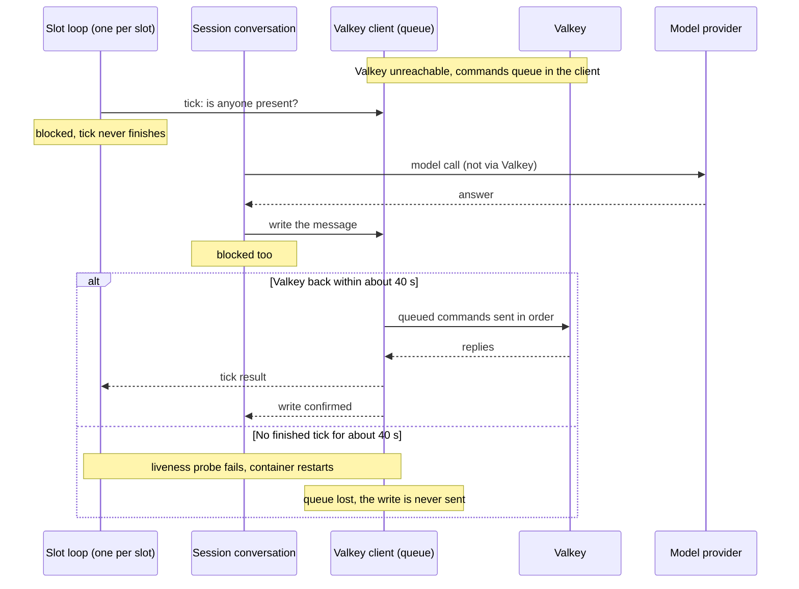

# Runner

The runner runs the Sessions ([architecture §1](../architecture.md#1-overview)): it decides when each slot starts one, has the Explorer and the Pretender take turns through the model provider, paces their messages, and writes every event and slot state to Valkey. It is the only writer of Sessions and slot state. One pod runs every slot (D24); how many there are is the runner's setting (D65).

What a Session does, step by step, is in the architecture ([§6](../architecture.md#6-a-sessions-life), [§7](../architecture.md#7-pacing), [§8](../architecture.md#8-spend-and-sleeping)). This doc covers how the runner is built and run. Terms such as *Codeword*, *present* and *watching* are as the [glossary](../../glossary.md) defines them.

## 1. What runs

| Object | Name | What it is for |
|---|---|---|
| Deployment | `runner` | One pod, replaced with the Recreate strategy (D24), from the Alpine variant of Bun's image (D56) |
| ConfigMap | `settings-<hash>` | The settings several components read ([shared component doc §4](shared.md#4-settings)) |
| ConfigMap | `runner-config-<hash>` | The runner's own settings (§5) |
| Secret | `llm-api` | The API key, created by Tilt from `.env` (D27, D48) |
| Secret | `valkey-passwords` | Only its `runner` entry is mounted ([Valkey component doc §6.1](valkey.md#61-where-the-passwords-come-from)) |
| NetworkPolicy | `runner` | No other pod may connect in, though the kubelet's probes still get in; it may connect out only to DNS, to Valkey, and to port 443 on public addresses (§6.3, D57) |

The code is in `apps/runner/`, the manifests in `deploy/base/runner/`. Each source file starts with a comment saying what it holds.

## 2. How it works

`slots.ts` and `session.ts` don't touch the network themselves: they get Valkey, the model and the clock passed in. That's what lets the tests run them against fake Sessions, a scripted model and a fake clock (§8).

### 2.1 The slot loops

Each slot has its own loop. Once a second, the loop checks its slot and moves it on if needed; the code calls one such check a *tick*. What each tick does is in [architecture §6.2](../architecture.md#62-one-session-step-by-step). With a loop per slot, one slot's slow Valkey command doesn't hold up the others.

The state of each slot is kept in the runner's memory, and written to Valkey on every change. Since only one runner exists at a time (D24), its memory is the truth; Valkey's copy is for the web server, and for the next runner after a restart.

**A Session runs alongside its loop.** Starting one launches the conversation in the background, and the loop keeps ticking meanwhile: when nobody is present, it stops the Session through an *abort signal*, a standard JavaScript object that the conversation, its waits and its in-flight call all listen to. The conversation then returns *interrupted* at once.

**Every ending is written in one place.** The conversation only writes messages. When it returns its ending, the slot loop writes `session-end`, sets the stream to expire, and moves the slot on:

- to idle, if the Session was stopped because nobody was present;
- to sleeping, if the machine now sleeps: the daily spend cap is reached, or the provider refused a call because the key's daily limit or the prepaid credit is spent (S6.2, D59);
- otherwise to the intermission.

If writing the ending fails, the slot waits in its intermission and later ticks try again, so the stream still gets its `session-end` and its expiry.

**Start-up:**

1. **Waits for Valkey.** Until Valkey answers, commands wait in the client's offline queue (§2.5), so start-up sends `PING` and gives it a few seconds; while there's no answer, it logs that it's waiting and tries again. If reading the previous states or ending a previous Session fails, for example because Valkey went away again, it waits a few seconds and starts over from here. Writing the new slot states isn't a step that fails: the writer tries again until it succeeds (§2.4), and start-up waits for it.
2. **Reads the previous slot states,** the last entry of the `slots` stream. For a slot beyond a lowered count, it ends a Session left running as interrupted, as in step 3, so its stream doesn't stay open forever; the slot itself just drops out of the list.
3. **Each slot's previous state:**
   - `running`: only a crash leaves a slot running, since a clean shutdown moves it to its intermission. Unless the stream already ends with `session-end` (a runner can die between writing it and moving the slot on), the runner ends the Session as interrupted, then starts the slot's intermission.
   - `intermission`: starts a fresh intermission.
   - `sleeping` or `idle`: kept as it is.
   - Nothing at all: set to idle.

**Shutdown:** on SIGTERM, the runner stops every running Session, waits until each ending and the last slot states are written ([architecture §9](../architecture.md#9-when-things-fail)), and exits, normally well under a second. While Valkey is down, those writes wait in the offline queue, and a slot-state write that keeps failing keeps being tried (§2.4), so shutdown waits until Kubernetes kills the pod after its 30-second grace period; the next runner's start-up then ends those Sessions. A 30-second shutdown is therefore expected during a Valkey outage, not a bug.

### 2.2 A Session's conversation

As in [architecture §6.2](../architecture.md#62-one-session-step-by-step):

- **Turns:** the Explorer goes first. Each turn sends the role's model its instructions and the whole history, with its own messages as `assistant` and the other's as `user`. Only the text is kept, so no reasoning is carried over (S5.4).
- **Pacing ([architecture §7](../architecture.md#7-pacing)):** a message is written only once the previous one has been revealed in browsers, with 10% slack (`PACING_FACTOR`). The next call starts as soon as a message is written, so generating overlaps with revealing. The first message is written as soon as it arrives.
- **Found:** an Explorer message containing the Codeword exactly, case included. The Codeword in a Pretender message doesn't count.
- **Retries:** a failed call is tried again after a short wait; the third failure in a row for the same message ends the Session as interrupted (S2.5).
- **Spend:** every call's cost is added to the day's spend: failed calls too, since some still cost money (a reported cost of 0 adds nothing), and calls answered after the Session was stopped. The cost and the day's total go to the log (S6.5).

**The Codeword** is an adjective, a noun and a verb, drawn at random from the word lists of the Pretender's kind, in `apps/runner/words/<kind>/`, such as `verbose-keepalive-hibernates` (D63). The author chooses and checks the lists, which is how offensive words are kept out (S3.2), and themes them per kind. An empty list stops the runner at start-up, rather than failing later when a Codeword is drawn. The Pretender's prompt has `<Codeword>` where the Codeword goes.

### 2.3 Calling the model provider

`llm.ts` calls the chat completions API through the `openai` package, with its base URL set to `LLM_BASE_URL` (D13), so any OpenAI-compatible API works (S5.2). The package gives request and response types and error classes.

- **No retries of its own:** the package retries some failures twice more by default; that's turned off, since the runner retries on its own (§2.2) and the two would multiply.
- **Timeout:** generous while the models are tried, so that slow reasoning isn't cut off. A call that times out is still billed by the provider, but the runner never learns its cost, so it counts as nothing towards the day's spend; the key's daily limit at the provider (S6.3) is the backstop. The longest a Session can stand still before it ends as interrupted is three timed-out tries plus the waits between them, a frozen screen of many minutes. To be shortened once the trial runs show how long calls really take.
- **Cost:** OpenRouter puts each call's cost in `usage.cost`. The package keeps the field but its types don't know it, so `llm.ts` has a small type for it (D13). A provider that doesn't report a cost counts as 0.
- **Cut-off messages:** `max_tokens` caps a message's length (S5.3). A message that reached the cap (`finish_reason` `length`) is kept as it was cut, and logged. An empty one is a failure to retry: a reasoning model can spend the whole cap on reasoning and answer nothing.
- **Limit refusals:** OpenRouter names the limit in `error.metadata.limit_source`. `openrouter_key_limit` (the key's daily limit, S6.3) and `openrouter_credits` (prepaid credit spent, D59) aren't retried: the Session ends as *sleeping*, and the runner sets `sleeping:{date}`. OpenRouter's docs disagree on whether the status is 402 or 403, so only the name is used; the tests check both.
- **Everything else** is a failure to retry, logged with its HTTP status when there is one.

### 2.4 Reading and writing Valkey

Every command is in `store.ts`. The runner's Valkey user allows exactly the commands it uses ([Valkey component doc §6](valkey.md#6-users-and-permissions)), and the tests log in as that user, so a missing permission fails them.

- **Slot states:** every change leads to a write of every slot's state, from memory, as one entry on the `slots` stream (D65, [architecture §4.2](../architecture.md#42-slot-state)). Memory changes first, then a single writer (`slot-states-writer.ts`) writes the states as they are when its write starts. Only one write is ever under way, so writes can't land out of order:
  - **Changes during a write** go out together in the next write, so when two slots change at once, the last entry has both.
  - **A failed write** is logged and tried again after a pause, for as long as it takes; the writer never gives up on a change.
  - **Starting a Session waits** until Valkey shows the slot running, and the conversation starts after that, so nobody can be told about a Session that then doesn't happen. While Valkey refuses, that slot's loop waits too; after 10 s liveness fails, and about 40 s in the runner is restarted, as in any Valkey outage (§2.5). Start-up and shutdown wait for their writes too. Other changes don't, so a write that keeps failing doesn't hold up stopping a Session nobody watches, or recording an ending.
  - **Shutdown** waits until the last states are written.
- **Stream lengths** are capped with `MAXLEN ~`, which lets Valkey trim in whole blocks, cheaper than trimming exactly. The limits are only a safety net.
- **Unreadable data:** a stream entry or slot state that doesn't match its schema reads as nothing, with a warning in the log, so a schema mismatch or corrupted data shows up instead of being skipped silently.

### 2.5 When Valkey is away

**How the client behaves.** The runner talks to Valkey through Bun's Valkey client. When the connection drops, the client tries to reconnect, over and over, waiting a little longer between tries, up to 2 s. Meanwhile it doesn't fail the runner's commands: it keeps them in its *offline queue*, a waiting list it sends once the connection is back. So a command sent during an outage doesn't fail; it just doesn't finish until Valkey is back.

**A short outage,** such as a Valkey restart of a few seconds: the waiting commands go out once the client has reconnected, and everything continues. Nothing is lost; viewers see a short stall.

**A long outage.** The runner's ticks wait too, since each tick sends commands. Once no tick has finished for 10 s, the liveness endpoint fails, and after three failed probes Kubernetes restarts the runner's container (§4), about 40 s into the outage. The new runner starts by waiting for Valkey (§2.1), and once Valkey is back, it ends the Sessions left running as interrupted. Tested in the cluster by stopping Valkey for 50 s.

What waits on what during an outage: a command waits in the client's queue, and so does the code that awaits it.



**Why the client is set never to give up.** By default, Bun's client stops trying after 20 attempts, about 30 s. After that, it fails every command at once, for good, even when Valkey is back (tested with a 45-second outage). The runner would then be stuck: its ticks would finish quickly, with errors, so the liveness probe would keep passing and nothing would restart it. `connectValkey` sets the limit to the highest number of attempts Bun accepts, which at 2 s per attempt is about 270 years. In practice, the restart above comes long before.

**Why not exit instead.** The alternative is to make the runner exit as soon as Valkey is gone, and let Kubernetes restart it. Two problems: the client reports every lost connection the same way, so a lasting failure can't be told apart from a short drop that would heal by itself; and a container that keeps exiting while Valkey stays down goes into *CrashLoopBackOff*, where Kubernetes waits longer and longer between restarts, up to 5 minutes, so the runner could come back minutes after Valkey does.

**Presence during an outage.** A running slot checks presence ([glossary](../../glossary.md)) on every tick. During an outage, that check waits like any other command. If it fails with an error instead, for some other reason, the runner counts viewers as present until the time without viewers runs out, rather than stopping the Session at the first error.

## 3. Logs

One JSON object per line on stdout (D47), with `slot` and `sessionId` where they apply. What gets logged: start-up, each slot state change, each Session start, Codeword and ending, each call's cost with the day's total, failed calls with their HTTP status, cut-off messages, unreadable data, and errors. Errors caught at the top level (a failed start-up, a failed tick, a failed Session, an ending that couldn't be written, a failed write of the slot states) are logged with their stack, so a failure can be traced from the logs alone. The start-up wait for Valkey is the exception: it repeats every few seconds while Valkey is away, so it logs only a short message, without a stack.

Each Session's Codeword is logged when it's chosen, which helps when checking why a Session did or didn't end as *found*. Message text isn't logged: messages can be long and come every few seconds, so they would swamp the log, and while a Session lasts its stream holds them anyway.

## 4. Health check

`GET /livez` answers 200 while every slot loop has finished a tick recently, and 503 otherwise (D29). A tick that fails with an error still counts: the probe asks whether the loop is alive, not whether Valkey is. A tick that *waits*, as during a Valkey outage (§2.5), doesn't finish, so a long outage does restart the runner.

A stuck loop is restarted after about 40 s: the endpoint fails once a loop hasn't ticked for 10 s, then Kubernetes restarts the runner's container after three failed probes, 10 s apart. The pod itself stays: it keeps its name, and its restart count goes up. During start-up, before the loops run, the endpoint answers 200.

The runner has no readiness probe, since nothing sends it traffic (D29).

## 5. Settings

| Setting | Environment variable | |
|---|---|---|
| Slot count | `SLOT_COUNT` | D65 |
| Exchange cap | `EXCHANGE_CAP` | S2.4 |
| Intermission, in seconds | `INTERMISSION_SECONDS` | S2.8 |
| Daily spend cap, in dollars | `DAILY_SPEND_CAP_DOLLARS` | S6.1 |
| Maximum message length, in tokens | `MAX_MESSAGE_TOKENS` | S5.3. Set high in `runner-config` while trying the models, so it cuts neither messages nor reasoning short; set properly after the trial runs |
| Provider endpoint | `LLM_BASE_URL` | S5.2 |
| Explorer's model | `EXPLORER_MODEL` | S5.1 |
| Pretender's model | `PRETENDER_MODEL` | S5.1 |
| Valkey's address | `VALKEY_HOST`, `VALKEY_PORT` | not set in `runner-config`: the defaults, `valkey` and 6379, apply |

The values are in `runner-config`, in `deploy/base/runner/kustomization.yaml`, plus the shared settings ([shared component doc §4](shared.md#4-settings)). The runner checks its own and the shared ones together, so an invalid or missing value stops it at start-up with one error naming every bad variable.

**The models have no default** (D62 chose them). If they're missing from `runner-config`, the runner stops at start-up with an error naming them, rather than starting and failing every call.

**Constants** ([shared component doc §4.1](shared.md#41-setting-or-constant) says which is which) are in `main.ts`, `runner.ts` and `session.ts`, each with a comment saying why. The pacing factor and the retry wait may be tuned after trial runs.

## 6. Kubernetes

### 6.1 Image

`apps/runner/Dockerfile` is built with the repository root as its build context (`docker build -f apps/runner/Dockerfile .`), because the runner needs `packages/shared` next to it. Bun runs TypeScript as it is, so there's no build step.

### 6.2 Secrets

Each Secret is mounted as a directory with only the runner's own entry, read once at start-up (D37). A missing or empty file stops the runner with an error naming the file, never the value.

### 6.3 NetworkPolicy

`deploy/base/runner/networkpolicy.yaml` sets both directions for the runner's pod (D57):

- **In:** no other pod may connect. The kubelet's probes still get in, because Kubernetes lets traffic from a pod's own node through; tested on k3s.
- **Out:** the cluster's DNS, Valkey, and port 443 on any address outside the reserved ranges: the private networks, link-local and carrier-grade NAT. The cluster's own pods and Services are inside the private ranges.

A NetworkPolicy matches addresses, not names, so "only OpenRouter" can't be written: the rule opens port 443 to any public address. D57 explains the choice. Allowing only one name would need a network plugin with name-based policies, such as Cilium, in place of k3s's own; that's an idea for later ([roadmap](../../../ROADMAP.md#ideas-not-promises)), and its own decision if it comes.

**Consequence:** a model server on the local network (S5.2 allows a local provider) is blocked, since it has a private address. Running one would need a rule for its address.

### 6.4 Development

Tilt builds the image and deploys it (`Tiltfile`). In development the container runs `bun --watch`. Tilt copies changed files from `apps/runner/` and `packages/shared/src/` into the running container, and Bun restarts the process. Every change therefore interrupts running Sessions, which in development is fine.

**A start-up error doesn't restart the container in development.** `bun --watch` doesn't exit when the program fails; it waits for the next file change. The pod stays *Running*, and the error is in its log and in Tilt. With the image's own command, as outside development, the process exits and Kubernetes restarts the container.

## 7. Failure behaviour

| What fails | What the runner does |
|---|---|
| A model call | Retries, then ends the Session as interrupted (§2.2) |
| The key's daily limit, or the prepaid credit | Ends the Session as sleeping, sets `sleeping:{date}`, and every slot sleeps until midnight UTC |
| Valkey restarts | Commands wait while the client reconnects, and everything continues |
| Valkey is away for more than about 40 s | Liveness fails and the runner is restarted (§4); once Valkey is back, the new runner ends the Sessions left running as interrupted (§2.5) |
| Valkey is away at start-up | Waits, logging every few seconds |
| A slot loop gets stuck | Liveness fails, and Kubernetes restarts the container after about 40 s (§4) |
| The runner is stopped (deploy, `kubectl delete pod`) | Ends running Sessions as interrupted and starts their intermission. During a Valkey outage, waits until it's killed after 30 s (§2.1) |
| The runner crashes | The next runner ends the Sessions left running as interrupted |
| A setting or Secret is missing or invalid | Stops at start-up with an error naming it, never a Secret's value. The container restarts, with the error in its logs; in development it stays running with the error in its log (§6.4) |
| Recording an ending fails | Logged with its stack. The slot waits in its intermission, later ticks write the ending, and then the intermission ends as normal |

## 8. Running and testing

From the repository root:

```bash
bun test apps/runner
```

The tests need Docker: those touching Valkey start a throwaway Valkey container from the cluster's image, with the cluster's user list (`@exhibition/shared/testing`), and log in as the runner's own user. They take a few seconds. Each test file starts with a comment saying what it covers. In short:

- **Each part on its own:** settings and Secret files, Codewords and their word lists, the health check.
- **Model calls,** against a fake provider: the request, cost, cut-off messages, OpenRouter's limit refusals under either status, failures with their status, timeouts and stopping.
- **A Session,** with scripted models on a fake clock, where sleeping only moves the clock, so pacing is checked exactly and the tests take no time.
- **Valkey operations:** every read and write, expiry times and the fallbacks for unreadable data included.
- **Slot loops,** with fake Sessions that end or fail when the test says.
- **The happy path, end to end** (`runner.test.ts`): a watched slot runs a whole Session through the real slot loop, conversation, model calls and Valkey operations, with the real prompts and word lists, until the Explorer finds the Codeword. It checks only what crosses the runner's boundaries: what it sends the provider and what it leaves in Valkey.

The fake provider runs inside the test process, on this machine, outside the cluster and its NetworkPolicy; that's why it can be reached at a local address that the runner's pod couldn't.

`main.ts` has no tests of its own: it only starts and stops the parts. Running it in the cluster checks it (below).

**Not yet checked in the cluster: a Session with real models.** That needs a real key, and costs a few cents. It's the first real run: it tries each reasoning effort level (D62), which first needs a setting for the effort, after which the placeholders (message length, pacing) get tuned.

**Checked in the cluster** with a placeholder key, which makes every call fail, so nothing is spent:

- Setting `presence` and `watching:1` through the `admin` user, as a viewer would, starts a Session in slot 1; after three failed calls it ends as interrupted and the slot goes to its intermission.
- Deleting the pod while a Session runs: the log shows "shutting down", the Session ends as interrupted, and the new pod picks up the intermission.
- Scaling Valkey to 0 for 50 s: the liveness probe fails, Kubernetes restarts the runner, and it starts once Valkey is back.
- The NetworkPolicy, from inside the runner's pod: `openrouter.ai:443` and `valkey:6379` connect. The Kubernetes API (`10.43.0.1:443`) and a private address are refused, and so is `openrouter.ai:80`, since only port 443 is open. From a throwaway pod, connecting to the runner's health port is refused. The liveness probe keeps passing.
- Missing models and an empty API key file each stop the runner at start-up with an error naming them, never the key's value. In development the pod then stays running with the error in its log (§6.4).
- Lowering `SLOT_COUNT` from 3 to 2 removed `slot:2` and rewrote `slot-count`; raising it back recreated the slot as idle. Checked before D65; since then the slot loop tests cover it (a shorter list, then a new idle slot), and it's still to recheck in the cluster.
- Starting the runner while Valkey is down: it logs that it's waiting every 5 s, and starts as soon as Valkey answers.
- The NetworkPolicy's reserved ranges: a link-local address (`169.254.169.254`, where cloud metadata services answer) and a carrier-grade NAT address are refused too.

To see the runner's logs:

```bash
kubectl logs -n exhibition deploy/runner -f
```

## Sources

- [OpenRouter: errors](https://openrouter.ai/docs/api-reference/errors), [OpenRouter: usage accounting](https://openrouter.ai/docs/use-cases/usage-accounting), [OpenRouter: limits](https://openrouter.ai/docs/api_reference/limits.md) (checked November 2026)
- [openai on npm](https://www.npmjs.com/package/openai), version 7.62.0 (checked November 2026)
- [Bun: Valkey client](https://bun.com/docs/runtime/redis), [Bun: Docker images](https://hub.docker.com/r/oven/bun) (checked November 2026)
- [Kubernetes: NetworkPolicies](https://kubernetes.io/docs/concepts/services-networking/network-policies/), [Kubernetes: liveness probes](https://kubernetes.io/docs/tasks/configure-pod-container/configure-liveness-readiness-startup-probes/), [Kubernetes: CrashLoopBackOff](https://kubernetes.io/docs/concepts/workloads/pods/pod-lifecycle/#container-restarts) (checked November 2026)
- [Tilt: live update](https://docs.tilt.dev/live_update_reference.html) (checked November 2026)
